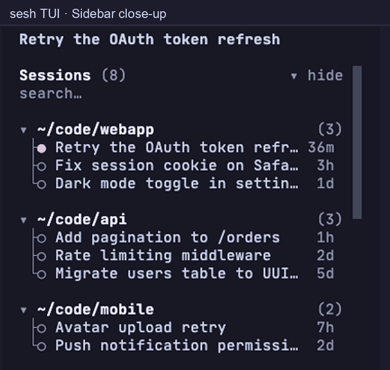

<h1 align="center">
  
</h1>

<p align="center">
  <a href="https://github.com/ozandogrultan/opencode-sesh/actions/workflows/ci.yml"></a>
  <a href="https://www.npmjs.com/package/opencode-sesh"></a>
  <a href="LICENSE"></a>
  <a href="#contributing"></a>
  <a href="https://github.com/ozandogrultan/opencode-sesh/stargazers"></a>
</p>

**An [OpenCode](https://opencode.ai) plugin and terminal session browser.** Search every session
across every project, preview the transcript, and resume in place — from your
terminal or from inside the TUI.

`opencode` keeps a growing pile of sessions, and its native lists (`<leader>l`,
`/sessions`) are scoped to the current project. `sesh` shows all of them —
grouped by directory, full-text searchable, and previewable from anywhere.

<p align="center">
  
</p>

**Install:** `npm install -g opencode-sesh && sesh install` for the terminal
picker, or add `"opencode-sesh"` to `plugins` for the TUI panel
([details](#install)).

## Why sesh

- **Every session, everywhere.** Sessions are grouped by project directory and
  shown across *all* your projects, not just the current one. Archived and
  subagent child sessions are hidden by default.
- **Pin what matters.** Ctrl-S pins a session and Ctrl-D pins its directory in
  either picker; the TUI sidebar and home list use Option-S and Option-R.
  Pins are shared and persist across restarts. Pinned directories rise first
  (followed by directories containing pinned sessions in the TUI picker);
  pinned sessions sort first in the terminal picker and home list, while the
  TUI picker and sidebar keep sessions within each directory ordered by recency.
- **Full-text search.** Type to match against session titles *and* the text of
  the conversation itself. Reasoning and tool output are excluded, so the index
  stays clean.
- **Transcript preview.** Ctrl-P in the terminal picker or Option-P in the TUI
  shows the most recent messages first, rendered as Markdown (with `glow` in
  the terminal if you have it).
- **Resume in place.** Enter runs `opencode --session <id>` in the session's
  own directory. Ctrl-F forks instead. The session opens in the same terminal,
  and exiting opencode returns to the picker — no tabs, panes, or window management.
- **Native TUI, too.** A sessions section in the opencode sidebar plus an
  `option+o` picker, both themed by your opencode theme.
- **Fast.** The database is scanned once per refresh and cached; keystrokes only
  re-render the last snapshot, so typing never triggers a query storm.

## Install

### OpenCode plugin

Add the package to `plugins` in your `opencode.json` (server tool)
and `cli.json` (TUI panel):

```json
{
  "plugins": ["opencode-sesh"]
}
```

OpenCode installs the package and loads its server tool and TUI panel. The
published panel is precompiled (`dist/tui.js`) because OpenCode does not apply
its Solid transform to sources under `node_modules`. Merge this entry with your
existing plugins. Remove any copied
`./tui-plugins/sesh-panel` registration and `plugins/sesh-list.ts` tool before
switching to avoid loading them twice.

### Terminal picker

<p align="center">
  
</p>

Install the CLI with npm:

```bash
npm install -g opencode-sesh
sesh install
```

Or from source:

```bash
git clone https://github.com/ozandogrultan/opencode-sesh.git
cd opencode-sesh
bash install.sh
```

`sesh install` (or `bash install.sh`) links `sesh` into `$XDG_BIN_HOME`
(default `~/.local/bin`), copies
the `sesh_list` tool and the TUI panel into
`${XDG_CONFIG_HOME:-~/.config}/opencode`, registers `./tui-plugins/sesh-panel` in `opencode.json`, and
declares the plugin dependencies (opencode installs them on next start). The
panel registers the `/sesh` slash command. It never edits your shell rc or
overwrites a foreign `sesh` symlink.

The npm package ships the same scripts and installer; the runtime tools below
are still required.

OpenCode reloads plugins when watched configuration files change. If a panel update
does not appear, fully quit opencode and reopen it. Upgrades
refresh an already-installed panel automatically (the npm `postinstall` syncs
it), and `sesh --check` reports when the installed panel is out of date.

Then:

```bash
sesh              # terminal picker
```

```text
/sesh             # inside opencode — picker (TUI plugin)
option+o          # inside opencode — picker
```

### Requirements

- [opencode](https://opencode.ai), used at least once
- `bash`, `jq`, and [`fzf`](https://github.com/junegunn/fzf) (modern stock build; run `sesh --check` to verify)
- `sqlite3` — the picker queries the session DB directly
- [`glow`](https://github.com/charmbracelet/glow) optional — styles the
  transcript preview as Markdown; without it the preview shows the plain
  Markdown, unchanged otherwise

### Uninstall

```bash
sesh uninstall        # npm installs
bash install.sh --uninstall   # from source
```

## Usage

### Terminal picker

| Key | Action |
| --- | --- |
| Type | Search titles and transcript text across all directories |
| Enter | Resume the selected session in this terminal |
| Ctrl-F       | Resume as a fork (the original is untouched) |
| Ctrl-G | Toggle current-directory scope / all sessions |
| Ctrl-S / Ctrl-D | Pin or unpin the selected session / directory |
| Ctrl-P | Toggle the transcript preview |
| `?` (empty query) | Toggle shortcut help |
| Ctrl-X | Delete the selected session (asks to confirm) |
| Escape | Exit |

The header line always shows the effective scope, the session count and whether
the index is fresh or stale, so a `Ctrl-G` toggle is never silent. A query that
matches nothing says so instead of showing an empty screen.

Flags: `--cwd` (current directory only), `--limit N` (default: all),
`--archived`, `--print` (print `id<TAB>cwd` instead of resuming), `--fork`,
`--json` (with `--print`, emit JSON), `--query TEXT`, `--check`,
`--needs-input` (list sessions waiting on you instead of opening the picker).

`sesh prune [--older-than 30d] [--dry-run] [--yes]` deletes stale
sessions (not updated within the threshold) through `opencode session delete`, including their children.
Pinned sessions and directories, sessions waiting on you, subagent child sessions and already-archived
sessions are never selected. Without `--dry-run`, a TTY run
confirms first and a non-TTY run needs `--yes`.

`sesh costs [--days N] [--json]` sums assistant-message cost per project, with a
recent window beside the lifetime total, so a day's work reads as a
per-project record. Earlier history tables are included when present in the
database, and sessions are counted only once.

When searching, title matches outrank transcript-only matches and the current
project rises, so the list answers "where was that thing I worked on" before it
answers "what is newest". Pins still win outright.

`--print` still opens the interactive picker, but emits the selected id and
directory instead of resuming. `--query` supplies the initial search text:

```bash
read -r id cwd < <(sesh --print --query "auth")
sesh --print --json --query "auth" | jq -r .cwd
```

Deleting is irreversible, so the picker asks before dispatching it, and a
non-interactive `sesh-delete.sh` refuses unless given `--yes`.

### TUI picker

| Key | Action |
| --- | --- |
| `/sesh` | Open the full picker |
| `/sesh-costs` | Per-project cost digest (24h beside lifetime) |
| `/sesh-needs` | Sessions waiting on you (Enter opens) |
| `option+o` | Open the full picker (also in the command palette) |
| Type | Search titles, directories and transcript text |
| `↑`/`↓` or Ctrl-P/Ctrl-N | Move the selection up/down |
| `PgUp`/`PgDn`, `Home`/`End` | Move by page or jump to the first/last session |
| Option-P | Toggle the transcript preview |
| Enter | Open the selected session |
| Option-D | Arm deletion; press Option-D again, `y`, or Enter to confirm |
| Ctrl-F | Fork the selected session |
| Ctrl-G | Toggle scope: the selected session's project, or every project |
| Option-W / Option-S | Show only sessions needing input / pinned sessions |
| Ctrl-S / Ctrl-D | Pin or unpin the selected session / directory |
| Esc | Close the preview first, then the picker |

While deletion is armed, `n` or Esc cancels; it also cancels after five seconds.
Option-O opens the picker globally; the other keys above apply inside it.

The picker groups sessions under collapsible directory headings (click ▾/▸).
Mouse-wheel scrolling moves through the tree without changing the selection
under a stationary pointer. Option-P opens a full-size transcript preview over
the picker; use ↑/↓ or Ctrl-P/Ctrl-N to preview other sessions, then Esc to
return to the list.
Right-click a sidebar session to open its action menu: open, preview, fork,
pin/unpin, or delete with confirmation. Inside cmux, the menu also offers opening
the session in a new workspace at its directory. Use ↑/↓ and Enter to choose an
action, or Esc to dismiss the menu.
Right-click a session in the home list or picker to open it in a new cmux
workspace at its directory; outside cmux it shows a toast instead.

### TUI sidebar and home list

`sidebarPlacement` (`"append"` or `"prepend"`, default: `"append"`) places the
**Sessions** section below or above OpenCode's native sidebar sections. With
`"append"`, native todos appear above Sessions when available.

`showSidebar` (boolean, default: `true`) controls whether the **Sessions** section
appears in the sidebar. Set it to `false` to hide the section while keeping the
home list, session picker, and other commands available. OpenCode's native sidebar
is unaffected. In `cli.json`, replace the existing `"opencode-sesh"` string entry
with the object below; do not add a second entry. Keep other plugin entries and
the `opencode.json` entry unchanged:

```json
{
  "plugins": [
    {
      "package": "opencode-sesh",
      "options": { "showSidebar": true, "sidebarPlacement": "append" }
    }
  ]
}
```

When the section is visible, click its `search…` box to filter sessions in place; click
elsewhere or press Esc to leave search. Click the **Sessions** heading to drive
the list from the keyboard instead of the mouse (`↑`/`↓` to move, Enter to open,
Option-P to preview, Option-S to pin a session, Option-R to pin its directory,
Option-D to arm deletion, Esc to leave). Press Option-D again, `y`, or Enter to confirm
an armed deletion; `n` or Esc cancels. Pinned
directories rise first, while sessions within each directory are ordered by
last update, newest first. The section lists every session and scrolls to fill
the sidebar, so click **▾ hide** to collapse it when you need the room.
Sessions waiting on you (unanswered agent questions, runs stuck mid-tool) pin
themselves to a **Needs input** group above the directories, with the count in
the heading; `sesh --needs-input` lists the same set in the terminal. Row
markers are the only status signal: a loading spinner marks the session whose
agent is working; the open session shows ● and every other row stays neutral.
Hovering a row while keyboard navigation is active selects it for the next
shortcut. Clicking (or Enter on) a session opens it here. The full picker is one
keystroke away.

The home list also supports search and the Option-P, Option-S, Option-R, and
Option-D actions on the hovered session. These Option pin shortcuts do not
replace the picker's Ctrl-S/Ctrl-D bindings; Option-S in the picker filters pins.

### Transcript search and needs-input triage

The full picker pages through your global session list
and indexes transcript text for every session in the background, showing
indexing progress under the search box (and noting if the safety cap is reached).
Transcript matches show a short excerpt
under the result; the Project, Needs input, and Pinned filters combine with
search. The picker remembers your query and filters until you restart opencode.
The Needs input dialog (`/sesh-needs`) shows why and how long each session has
been waiting, oldest first. Use ↑/↓ or Ctrl-P/Ctrl-N to navigate and Enter to
open the selected session. Press `n` there to open the next waiting session,
or reopen it after answering one to continue through the list.

## Configuration

All variables are optional.

| Variable | Default | Effect |
| --- | --- | --- |
| `SESH_DB` | `${XDG_DATA_HOME:-~/.local/share}/opencode/opencode.db`, falling back to `opencode debug paths` | opencode SQLite database |
| `SESH_SQLITE` | `sqlite3` | query tool |
| `SESH_JQ` / `SESH_FZF` | `PATH` | explicit executable overrides |
| `SESH_GLOW` | first `glow` on `PATH` | optional Markdown preview renderer |
| `SESH_OPENCODE` | `opencode` | opencode executable (resume / delete) |
| `SESH_CACHE_DIR` | `${XDG_CACHE_HOME:-~/.cache}/sesh` | persistent search-index cache |
| `SESH_PINS_FILE` | `${XDG_DATA_HOME:-~/.local/share}/sesh/pins.json` | shared persistent session/directory pins |

## Integrations

sesh is terminal-agnostic apart from the TUI's right-click action. The
[`contrib/cmux/`](contrib/cmux/README.md) directory shows how to drive it from
cmux — command-palette entries, shortcuts, resuming a session in its own
workspace, and a global "resume from anywhere" hotkey — all caller-side.

## How it works

The `bin/` readers query the opencode session
store in SQLite (`session_v2` / `session_message`). Each refresh extracts session
metadata and text-only parts into a persistent per-session cache keyed on
`time_updated`, message count and the latest message timestamp, then atomically
publishes a `snapshot.jsonl`. Every keystroke re-renders that snapshot with `jq`
alone, so typing never starts competing database scans. Reasoning and tool
payloads are never indexed or previewed, and session ids are validated before
any SQL interpolation.

Flat scripts in `bin/` back the terminal UI and CLI subcommands — the picker,
serialized refresh worker, preview renderer, pin store, deleter, pruner,
waiting-session check, cost digest, and shortcut help. The TUI panel
(`tui-plugins/sesh-panel/tui.tsx`) is a SolidJS OpenTUI plugin that talks to the
opencode SDK over the same store; the npm package ships it precompiled as
`dist/tui.js`. The `sesh_list` agent tool reads the store read-only through
`bun:sqlite` and is discovered automatically from the global config directory's
`plugins/`.

## FAQ

**Does it replace opencode's native session list?** No. `<leader>l` and the
native `/sessions` command are untouched; `sesh` is additive.

**Is there an agent-facing list?** Yes — the `sesh_list` tool lets the model list
every session across all directories (the native `opencode session list` only
covers the current project) and offer to resume one.

**Where is my data?** It reads the opencode database read-only and caches
extracted text under `${XDG_CACHE_HOME:-~/.cache}/sesh` (or `SESH_CACHE_DIR`).
Nothing is uploaded anywhere.

**What if a lock stays busy after a crash?** Stop all sesh pickers before
manually removing the lock directory named in the error; for pin locks, also
fully quit OpenCode. Locks are never automatically reclaimed. Restart OpenCode
after upgrading so older plugin instances cannot reclaim locks. Interrupted
extraction temporary files may remain in the cache; remove them only after all
pickers have stopped.

**Does it work on Windows?** It targets macOS and Linux. WSL should work; native
Windows is untested.

**Why a separate terminal picker *and* a TUI panel?** The panel is always one
keystroke away while you work. The terminal picker is fullscreen and works from
any shell, including outside opencode.

## More OpenCode plugins

- [ghost](https://github.com/ozandogrultan/opencode-ghost) — suggests your next prompt as ghost text in the empty composer.
- [quill](https://github.com/ozandogrultan/opencode-quill) — local word completion and next-word prediction as you type.
- [ember](https://github.com/ozandogrultan/opencode-ember) — prices a cold prompt-cache rewrite before you send.

## Contributing

Issues and PRs are welcome. See [CONTRIBUTING.md](CONTRIBUTING.md) for the full
guide; this project follows the [Code of Conduct](CODE_OF_CONDUCT.md). Run the
checks before opening a PR:

```bash
bun install
bun run test         # builds dist/tui.js, then the fixture-database regression suite
bun run test:picker  # PTY picker suite
bun run typecheck    # tsc over tui-plugins/ and plugins/
bun run lint:sh      # bash -n on every script
```

`HOME=/tmp/fakehome bash install.sh` smoke-tests the installer without touching
your real opencode config. [AGENTS.md](AGENTS.md) documents the architecture and
the hard-won TUI rules.

## License

[MIT](LICENSE)
